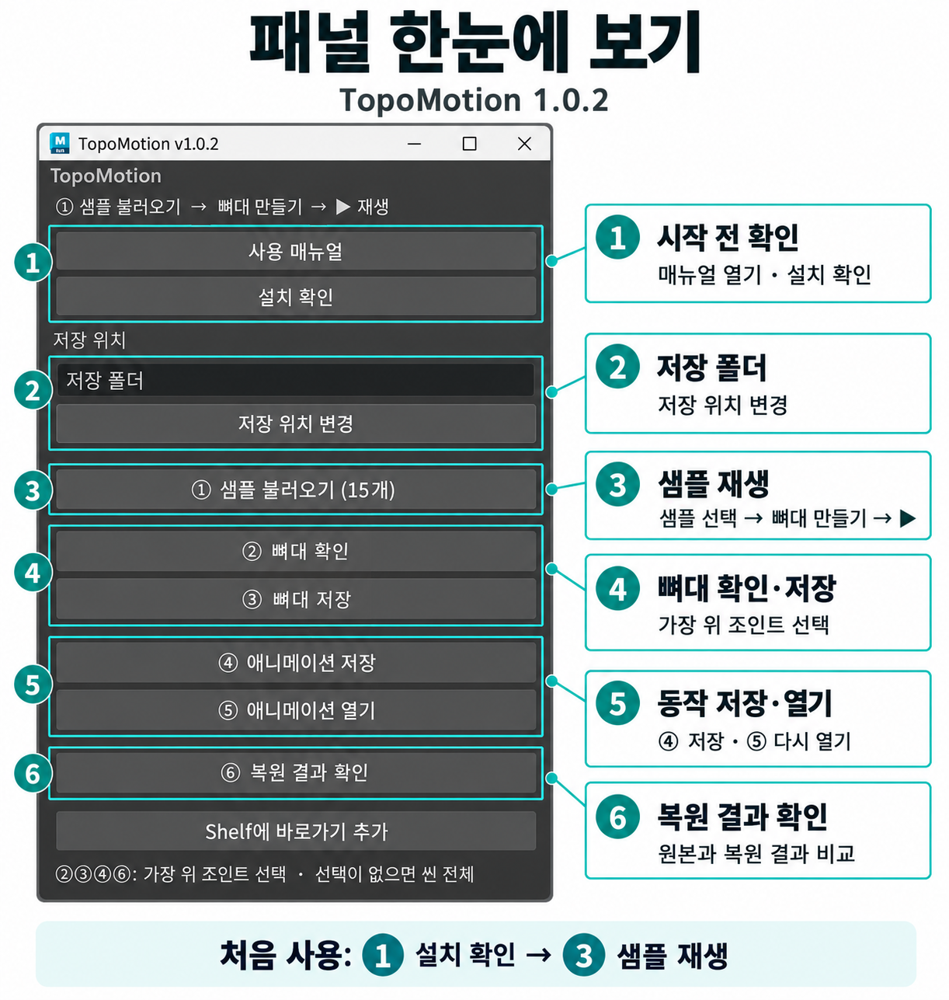

# TopoMotion for Maya

**학습한 모션 모델을 ONNX로 변환해, PyTorch 없이 Maya 안에서 CPU로 추론하는 플러그인**

[TopoMotion](https://github.com/kimwono/TopoMotion-showcase)(구조가 다른 골격을 하나의 그래프 모델로 압축·복원하는 개인 연구)의 **배포 부분**만 공개한 저장소입니다.
학습 코드와 데이터, 학습된 모델 파일은 포함하지 않습니다.

<p align="center">
  
  <br><sub>패널 안내 그림 (실제 패널 화면을 참고해 다시 그린 안내용 이미지)</sub>
</p>

## 무엇을 하나

- **설치**: ZIP을 Maya 뷰포트에 끌어다 놓으면 사용자 modules 폴더에 등록 (`install_topomotion.py`)
- **리그·모션 추출**: 씬의 joint 계층과 재생 구간을 world 행렬로 읽어 모델 입력(6D 회전)으로 변환
- **모델 추론**: 동결된 ONNX 모델을 vendor로 동봉한 ONNX Runtime으로 CPU 추론 — **PyTorch·인터넷 불필요**
- **복원 검사**: 입력과 복원 결과의 차이를 측지 각도(°)로 보고
- **샘플 재생**: 등록된 모션 15개를 선택해 새 joint/keyframe으로 재생

## 구조

```
maya_scripts/
  install_topomotion.py      # drag & drop 설치, Maya 버전별 modules 등록
  topomotion_plugin.py       # 명령·메뉴 등록/해제
  topomotion_panel.py        # 사용자 패널 (샘플 선택, 저장, 진단)
  maya_rig_export.py         # 리그 구조 읽기
  maya_anim_export.py        # 재생 구간 → world 행렬 (미터 단위)
  maya_import.py             # world 행렬 → joint/keyframe
  topomotion_core/
    featurize.py             # 행렬 → 6D 회전 특징 (numpy만 사용)
    reconstruct.py           # ONNX 추론 + 측지각 오차
    roundtrip.py             # 리그 추출→적용 왕복 검사
    playback.py              # 입력 검증, 단위 변환
  headless_*_check.py        # mayapy 헤드리스 배포 검사
topomotion/
  package_maya.py            # 사용자 배포 ZIP 생성 (표준 라이브러리만 사용)
tests/                       # Maya 없이 도는 회귀 검사 (14개)
docs/maya_plugin/            # 사용자 가이드, 배포 검증 기록, 유지보수 문서
```

## 검증

| 항목 | 결과 |
|---|---|
| Python 회귀 검사 (`pytest tests`) | 14 passed |
| Maya 2027 mayapy 헤드리스 검사 | 19개 항목 통과 (설치, 명령 로드, 오프라인 모델 로드, PyTorch 없는 경로, 왕복, 단위 cm/m, namespace 등) |
| 리그 추출 → 적용 왕복 | 행렬 차이 2.8×10⁻¹⁶ |
| PyTorch 없는 추론 경로 | 5.2 ms (대표 입력 31관절 · 32프레임, 파일 읽기·씬 갱신 제외) |
| 모델 크기 | 약 2 MB |

세부 기록과 **검증하지 않은 범위**는 [`docs/maya_plugin/VALIDATION.md`](docs/maya_plugin/VALIDATION.md)에 있습니다.

```bash
pip install numpy pytest
pytest -q tests
```

## 환경

- Windows 11 · Autodesk Maya 2027 (Python 3.13)
- 런타임 의존성: Maya 내장 NumPy, ONNX Runtime (배포 ZIP에 vendor로 동봉)

## 범위

- 지원: 복원 검사, 샘플 재생, 리그 왕복
- 미지원: 텍스트로 모션 생성(연구 진행 중), 다른 리그로 자동 전이, 메시·스킨·컨트롤러 복원
- 학습된 ONNX 모델과 샘플 모션은 이 저장소에 없어, 그대로 받아서는 Maya에서 실행되지 않습니다.

## 글꼴

사용자 가이드에 쓰인 Pretendard, JetBrains Mono는 각 원본 라이선스(OFL)를 `docs/maya_plugin/fonts/`에 함께 두었습니다.
